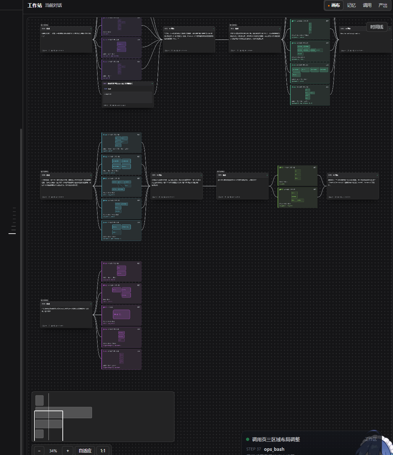
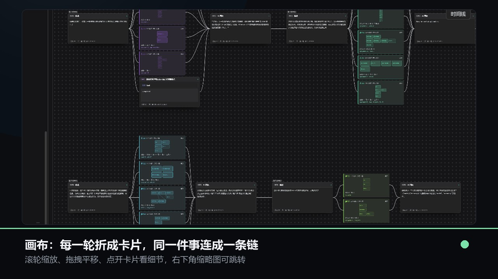
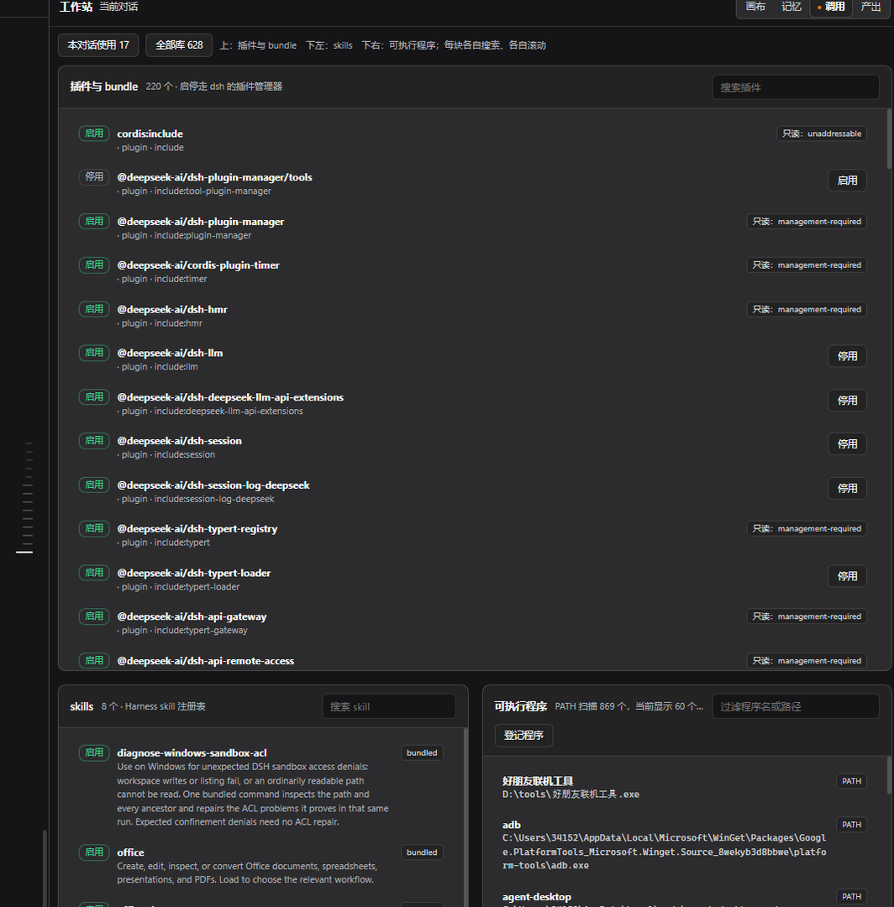
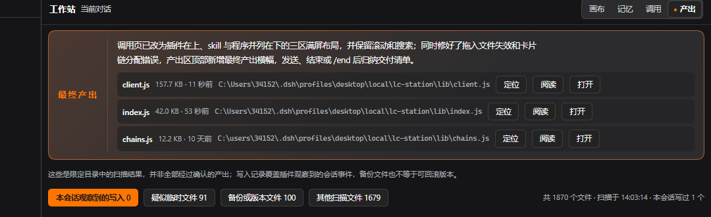

# LC Station · DSH Workstation

[中文](README.md) · **English**

> A local workstation for [DeepSeek Harness](https://github.com/deepseek-ai): the session event
> stream folded into a card-chain canvas, plus memory, calls and outputs panes.
> Everything runs on your machine; the chat path itself never calls a model.



[](media/demo.mp4)

*A 16-second demo — canvas / calls / outputs, no voice-over, captions and easing only. Click to play the mp4.*

---

## What it is

Every turn in DSH produces events: user messages, model replies, tool calls, file writes, subagents, compaction.
They sit scattered in the chat bubbles, so you cannot see what a turn actually did. LC Station folds them into
one card per turn, then links the turns that belong to the same piece of work into a **task chain** and lays
them out on a canvas you can pan and zoom.

Three side views come with it:

| View | What it does |
| --- | --- |
| Canvas | Card chains, lanes, timeline, minimap; click a card for details, drag to pan, wheel to zoom |
| Memory | Read / edit / append cross-session memory files; what was injected this session, what was extracted, what subagents recorded |
| Calls | Plugins & bundles, skills and programs in three panes, each with its own search; toggle plugins, register programs |
| Outputs | Bounded directory scan, changes and pre-images by turn, batch cleanup of temp files, and the **Final output** list |



The whole panel speaks Chinese and English: the **中 / EN** switch sits next to the view tabs
(top right of the Workstation page), and the choice is remembered in `localStorage`.
Conversation text inside the cards is never translated.

## Final output (end marker)

Send `发送` / `结束` / `/end` as a message of its own, and a "Final output" block appears at the top of the Outputs view:

- the upper part is **one sentence covering the whole conversation** — what was actually produced — written by
  the model (one call per marker, cached to disk);
- the lower part is **every file written across the conversation**, de-duplicated, newest first, each with
  reveal / read / open.

If you would rather write that sentence yourself, put it after the marker: `/end turn the login into a QR scan`.
Text after the marker wins over the model.



## Install

The plugin is a profile-local DSH plugin: drop it under the profile's `local/` directory and the Loader picks it up.

```bash
# 1) clone into the profile (adjust the path to your DSH_HOME)
git clone https://github.com/liangchen-h/lc-station.git ~/.dsh/profiles/desktop/local/lc-station

# 2) make sure your profile's cordis config can load it (plugin/cordis.patch.yml holds the insert line)
# 3) enable lc-station on the DSH Plugins page, or insert it in the profile's cordis.patch.yml
```

The repository keeps two copies: `plugin/` is the committable copy, the directory under the profile is what
actually loads. Sync them with:

```bash
LC_SRC=~/.dsh/profiles/desktop/local/lc-station node scripts/sync-plugin.mjs
```

## Configuration

| Variable | Default | Purpose |
| --- | --- | --- |
| `DEEPSEEK_API_KEY` | read from `~/.dsh/.credentials.yaml` | Used for chain judging and the final-output sentence |
| `LC_CHAIN_ENDPOINT` | `https://api.deepseek.com/chat/completions` | Point at a relay if you use one |
| `LC_CHAIN_MODEL` | `deepseek-chat` | Model used for judging |
| `LC_CHAIN_TIMEOUT` | `45000` | Chain judging timeout (ms) |
| `LC_SUMMARY_TIMEOUT` | `40000` | Final-output timeout (ms) |
| `LC_SRC` / `DSH_PROFILE` | — | Where `sync-plugin.mjs` finds the deployed directory |

Without a key the canvas still works: chains fall back to "turn order plus rule hints", and the final-output
sentence falls back to the text you appended after the marker, or the first paragraph of the last reply.

## How it works

```
DSH session events ──► cards.js ──► board (one band per turn, cards land on their band)
                        │
                        ├─► chains.js ──► chain assignment (rules + model, cached on disk)
                        ├─► memory.js ──► memory files / injection / extraction
                        ├─► calls.js  ──► plugins, skills, programs
                        └─► outputs.js ─► output scan, pre-image backup, rollback
                                   │
client.js (canvas / memory / calls / outputs) ◄── /lc/* routes
```

- **host half** `lib/index.js`: subscribes to `session/event`, maintains the board, registers the `/lc/*` routes;
- **client half** `lib/client.js`: browser module, four views plus canvas rendering (no framework, plain DOM);
- all state stays local: `.runtime/` holds session caches, write logs, judging and summary caches; `backups/` holds pre-write copies.

## Security model (read this)

This is a **local developer tool**. It assumes "whoever can reach this port is the local user".
Open-sourced on that premise:

1. **Localhost only**: the routes ride on DSH's web server, bound to `127.0.0.1`. **Never expose the DSH web
   port to a LAN or the internet** — that hands over this machine's plugin switches, memory files and output directories.
2. **No accounts**: no login, no tokens. Every write (POST) requires `content-type: application/json`, so another
   site forging requests with a form or a no-preflight fetch gets a 415 (the CSRF surface).
3. **File operations are bounded**: `/lc/file`, `/lc/outputs/retire*`, `/lc/outputs/restore`, `/lc/outputs/open`
   all pass through `underRoots()` first and may only touch paths under the output roots; memory writes must also
   match a known memory filename.
4. **Backup before write**: memory edits, output retirement and rollback all copy to `backups/<stamp>/` first and
   re-read to verify afterwards.
5. **Program download allowlist**: `/lc/raw` only serves programs already registered on the Calls page, and only
   with allowlisted extensions (`.exe .cmd .bat .ps1 .com .lnk`); anything else is 403.
6. **Two places call a model**: chain judging and the final-output sentence. What is sent is **your own words plus
   the first paragraph of the replies**; no file contents, no paths. If that bothers you, delete the calls in
   `lib/chains.js` / `lib/summary.js`, or simply do not configure a key.

## Known limitations

- Only exercised on Windows with the DSH desktop build; path handling is win32 semantics (`underRoots`, `prettyPath`).
- The canvas is hand-drawn DOM; thousands of nodes cost noticeable CPU. For huge conversations, switch to Memory/Outputs.
- Chain assignment depends on the model; without it, chains degrade into conservative merges.
- The output list depends on *write events*; files edited by external editors do not appear there (the `changed`
  category is a directory scan — it finds them, but cannot tell which turn they belong to).

## Layout

```
plugin/
  cordis.patch.yml      # bundle patch: inserts itself into the Loader
  package.json          # dsh.bundle / dsh.client manifest
  lib/
    index.js            # host half: event folding, /lc/* routes, pre-write backups
    client.js           # client half: canvas + four views (all styles included)
    cards.js            # events → cards, folded per turn
    chains.js           # chain assignment (rules + model)
    summary.js          # the one-line final output (model, cached)
    memory.js           # memory file read/write / injection / extraction
    calls.js            # plugins, skills, programs
    outputs.js          # output scan, pre-image backup, rollback
    paths.js            # directories, root allowlist, file info
scripts/
  sync-plugin.mjs       # deployed directory → repository copy
  layout-probe.mjs      # runs the layout functions offline on real cards
```

## Contact

Questions, bug reports, ideas: **3415299607@qq.com** — or open an issue on this repository.

## License

MIT
