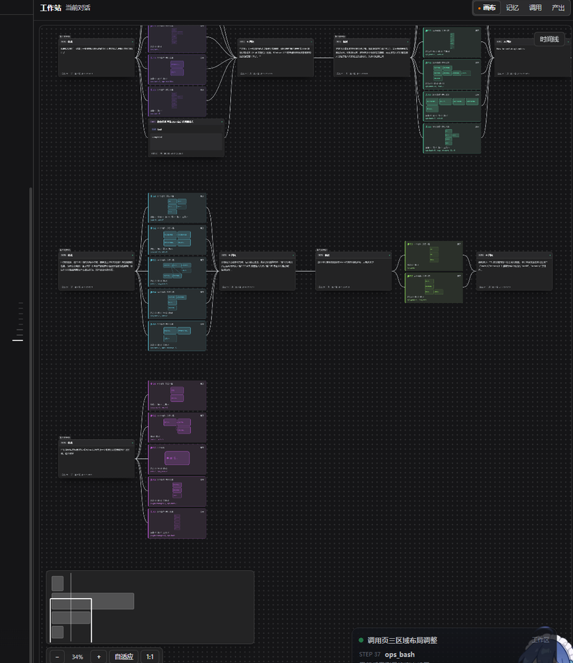
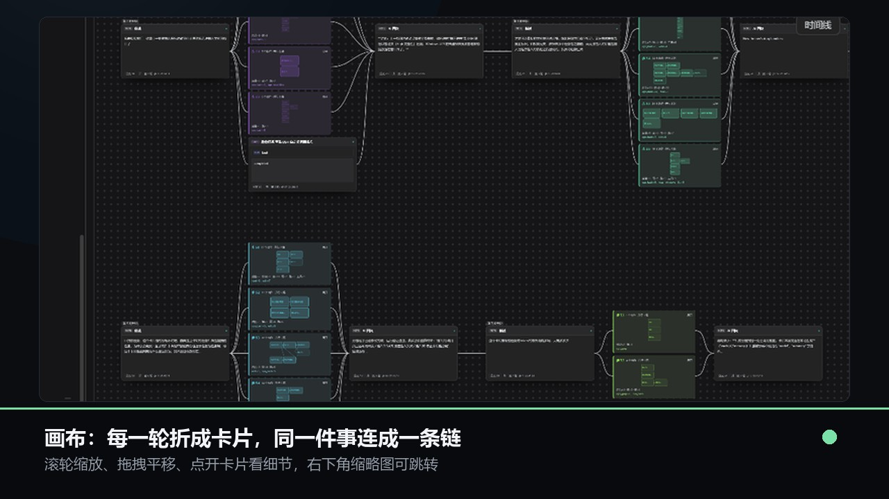
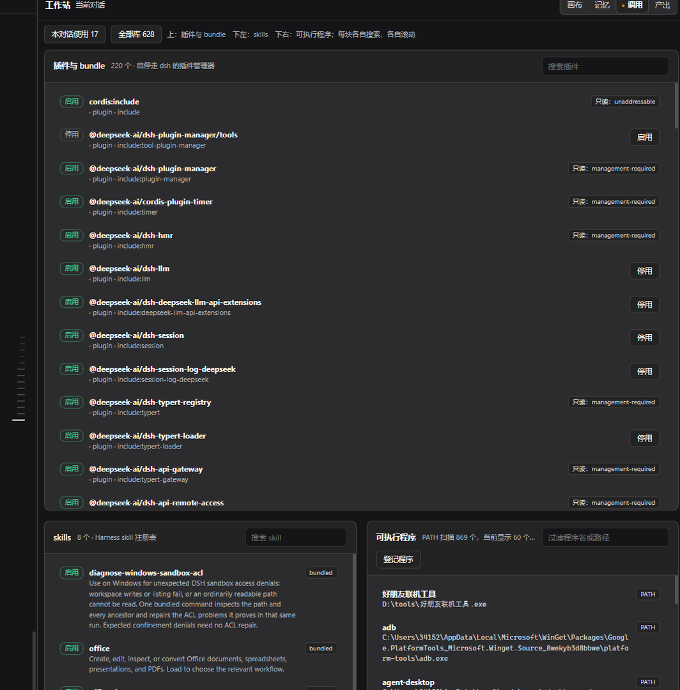
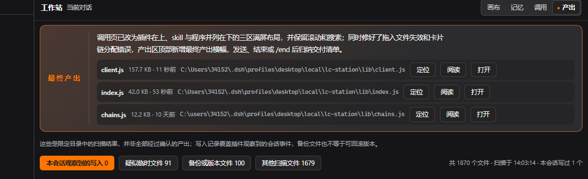

# LC Station · DSH Workstation

**中文** · [English](README.en.md)

> A local workstation for [DeepSeek Harness](https://github.com/deepseek-ai) — the session event
> stream folded into a card-chain canvas, plus memory, calls and outputs panes.
> 把 DSH 的会话事件流折成一张卡片链画布，外加记忆 / 调用 / 产出三个面板。纯本地运行，不对聊天路径调模型。



[](media/demo.mp4)

*16 秒演示：画布 / 调用 / 产出三段，无配音，字幕 + 缓动。点图看 mp4。*

---

## 这是什么

DSH 每一轮对话都在产生事件：用户消息、模型回复、工具调用、文件写入、子智能体、压缩。
这些事件平时散在对话气泡里，看不出"这一轮到底动了什么"。LC Station 把它们按轮折叠成卡片，
再把同一件事的多轮连成一条**任务链**，摊在一张可缩放、可拖动的画布上。

同时提供三个侧视图：

| 视图 | 做什么 |
| --- | --- |
| 画布 | 卡片链、泳道、时间线、缩略图；点卡片看细节，拖动画布平移，滚轮缩放 |
| 记忆 | 跨对话记忆文件的读取 / 编辑 / 追加，本会话注入了哪些、提炼了哪些、子智能体记了什么 |
| 调用 | 插件与 bundle、skills、可执行程序三块，各自搜索；插件可启停，程序可登记 |
| 产出 | 限定目录扫描、按对话轮查变更与前像、临时文件批量清理、**最终产出**清单 |



整个面板支持中英双语：**中 / EN** 开关在工作站页右上角、视图标签旁边，选择记在 `localStorage`。
卡片里的对话原文不翻译。

## 最终产出（结束标记）

在对话里单独发一条 `发送` / `结束` / `/end`，产出页顶部就会出现一块「最终产出」：

- 上半部分是**一句读完整个对话的话**——"这次到底做成了什么"，由模型归纳（每次标记只调一次，结果落盘缓存）；
- 下半部分是**整场对话写过的文件**，去重、按时间倒序，每行带「定位 / 阅读 / 打开」。

不想让模型写那句话时，直接在标记后面写你要的话：`/end 把登录改成扫码`。标记后的文字优先。



## 安装

插件是 DSH 的 profile-local 插件，放在 profile 的 `local/` 目录下即可被 Loader 发现：

```bash
# 1) 放进 profile（路径按你的 DSH_HOME 调整）
git clone https://github.com/liangchen-h/dsh-lcstation.git ~/.dsh/profiles/desktop/local/dsh-lcstation

# 2) 确认 profile 的 cordis 配置里能加载到它（plugin/cordis.patch.yml 是包内自带的 insert 行）
# 3) 在 DSH 的「插件」页里启用 dsh-lcstation，或在 profile 的 cordis.patch.yml 里 insert
```

仓库布局是「可提交副本」+「部署真源」两份：`plugin/` 是副本，实际加载的是 profile 下的目录。
同步用：

```bash
LC_SRC=~/.dsh/profiles/desktop/local/dsh-lcstation node scripts/sync-plugin.mjs
```

## 配置

| 变量 | 默认 | 作用 |
| --- | --- | --- |
| `DEEPSEEK_API_KEY` | 读 `~/.dsh/.credentials.yaml` | 任务链判定与最终产出归纳用 |
| `LC_CHAIN_ENDPOINT` | `https://api.deepseek.com/chat/completions` | 换中转站 |
| `LC_CHAIN_MODEL` | `deepseek-chat` | 判定用的模型 |
| `LC_CHAIN_TIMEOUT` | `45000` | 任务链判定超时（ms） |
| `LC_SUMMARY_TIMEOUT` | `40000` | 最终产出归纳超时（ms） |
| `LC_SRC` / `DSH_PROFILE` | — | `sync-plugin.mjs` 用来定位部署目录 |

没配 key 也不影响画布：任务链会退化成「按轮顺序 + 规则线索」分链，最终产出的那句话退化成
「标记附言」或「最后一条回复的首段」。

## 它怎么工作

```
DSH session events ──► cards.js ──► board（每轮一个 band，卡片按 band 归位）
                        │
                        ├─► chains.js ──► 任务链归属（规则兜底 + 模型判定，落盘缓存）
                        ├─► memory.js ──► 记忆文件 / 注入 / 提炼
                        ├─► calls.js  ──► 插件、skills、可执行程序清单
                        └─► outputs.js ─► 产出扫描、前像备份、回滚
                                   │
client.js（画布 / 记忆 / 调用 / 产出四个视图）◄── /lc/* 路由
```

- **host 半** `lib/index.js`：订阅 `session/event`，维护 board，注册 `/lc/*` 路由；
- **client 半** `lib/client.js`：浏览器模块，四个视图 + 画布渲染（无框架，纯 DOM）；
- 所有状态只在本机：`.runtime/` 存会话缓存、写入日志、判定与总结缓存，`backups/` 存写前备份。

## 安全模型（重要）

这是个**本地开发工具**，默认假设"能访问这个端口的人 = 本机用户"。开源放出，请按这个前提使用：

1. **只挂在本机**：路由注册在 DSH 的 web server 上，仅监听 `127.0.0.1`。**不要把 DSH 的 web 端口暴露到局域网 / 公网**，否则等于把这台机器的插件开关、记忆文件、产出目录交出去。
2. **没有账号体系**：不做登录，不加 token。写操作（POST）统一要求 `content-type: application/json`，这样别的网站用表单或免预检 fetch 伪造请求会被 415 挡掉（CSRF 面）。
3. **文件操作有边界**：读文件 `/lc/file`、回收 `/lc/outputs/retire*`、恢复 `/lc/outputs/restore`、打开 `/lc/outputs/open` 都先过 `underRoots()`，只允许产出根目录内的路径；记忆写入还要求命中已知的 memory 文件名。
4. **写前必留备份**：记忆写文件、产出回收、回滚前都会复制一份到 `backups/<时间戳>/`，回滚后再回读校验。
5. **程序下载白名单**：`/lc/raw` 只吐「调用页里登记过的程序」且扩展名在白名单内（`.exe .cmd .bat .ps1 .com .lnk`），其它一律 403。
6. **会调模型的两处**：任务链归属、最终产出那句话。发出去的内容是**对话里你自己说的话 + 回复首段**；不发文件内容、不发路径。介意的话删掉 `lib/chains.js`、`lib/summary.js` 里的调用，或干脆不配 key。

## 已知限制

- 只在 Windows + DSH 桌面版上跑过；路径处理是 win32 语义（`underRoots`、`prettyPath`）。
- 画布是自绘 DOM，节点数量上千时会明显吃 CPU；大对话建议先切到「记忆/产出」视图。
- 任务链归属依赖模型，模型不可用时会退化合并（宁可并一条，也不乱切）。
- 产出清单依赖「写入事件」；用外部编辑器改的文件不会出现在里面（`changed` 分类是目录扫描，能扫到，但不知道属于哪一轮）。

## 目录结构

```
plugin/
  cordis.patch.yml      # bundle patch：把自己 insert 进 Loader
  package.json          # dsh.bundle / dsh.client 清单
  lib/
    index.js            # host 半：事件折叠、/lc/* 路由、写前备份
    client.js           # client 半：画布 + 四个视图（含全部样式）
    cards.js            # 事件 → 卡片，按轮折叠
    chains.js           # 任务链归属（规则 + 模型）
    summary.js          # 最终产出的一句话（模型，缓存）
    memory.js           # 记忆文件读写 / 注入 / 提炼
    calls.js            # 插件、skills、可执行程序
    outputs.js          # 产出扫描、前驱备份、回滚
    paths.js            # 目录、root 白名单、文件信息
scripts/
  sync-plugin.mjs       # 部署目录 → 仓库副本
  layout-probe.mjs      # 用真实卡片离线跑布局函数
```

## 上架到 DSH 市场

仓库自带一份 format-1 索引 [`market/plugins.json`](market/plugins.json)，DSH 可以直接指向它（`DSHM_REGISTRY_URL=<url>`）；进官方精选列表的路子（往 `awesome-dsh-plugin` 提 PR，一天内生效）见 [docs/MARKET.md](docs/MARKET.md)。

## 联系

问题、bug、想法：**3415299607@qq.com**，或直接开 issue。

## License

MIT
